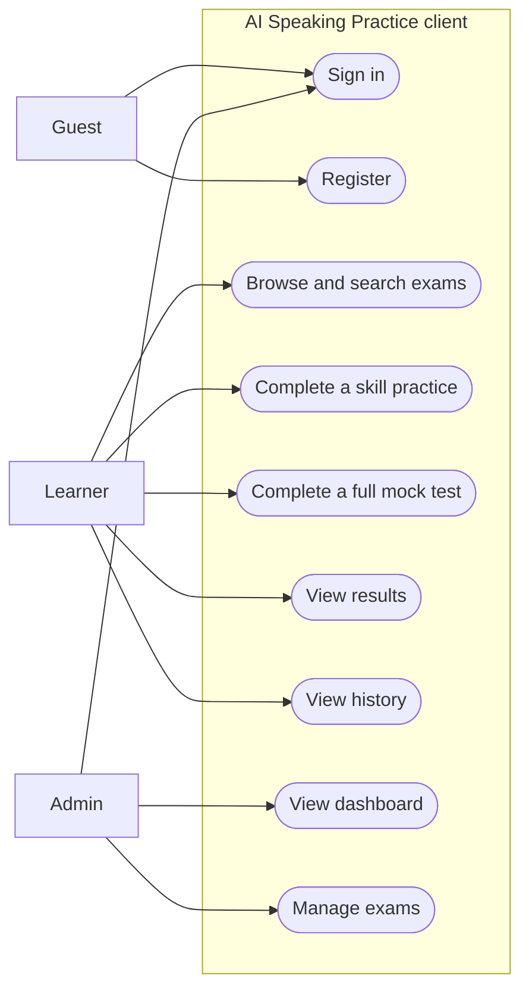
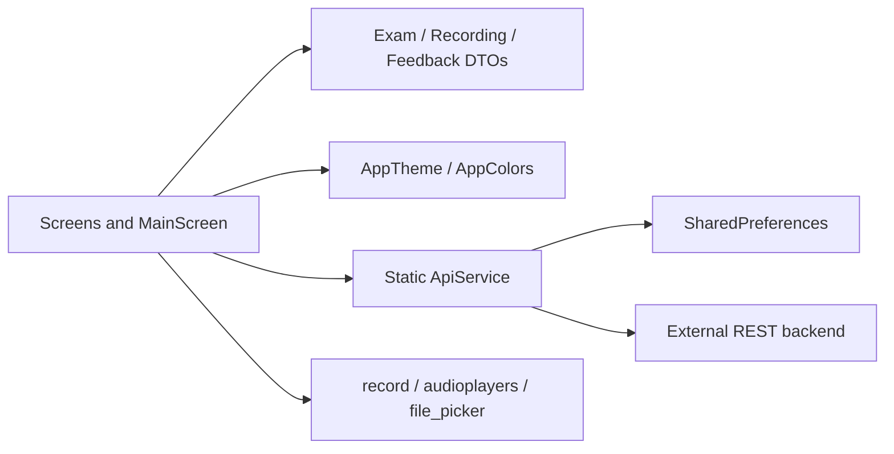
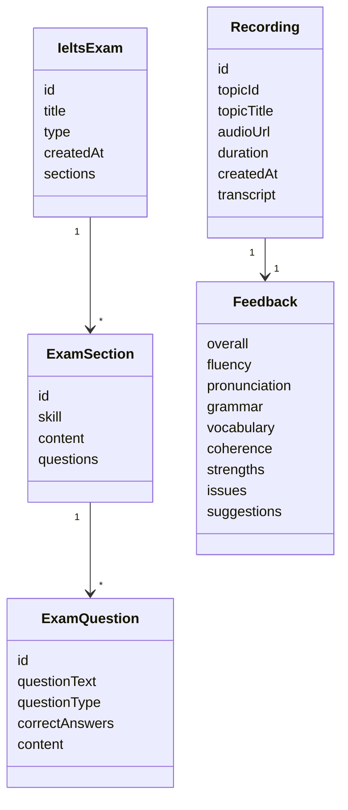
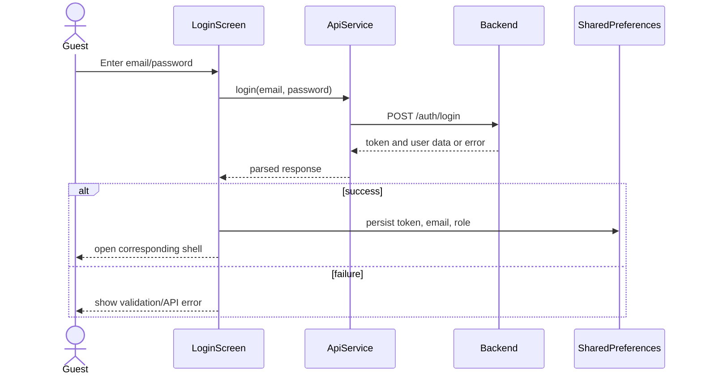
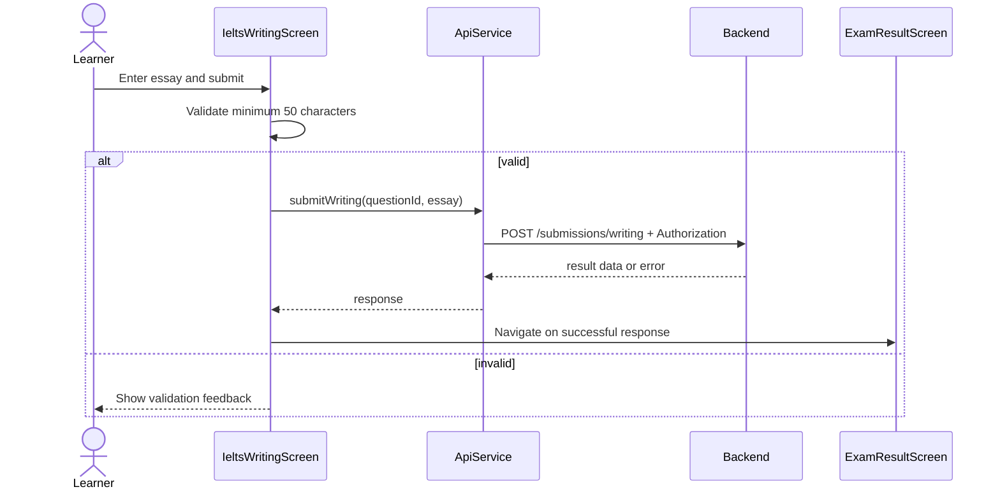
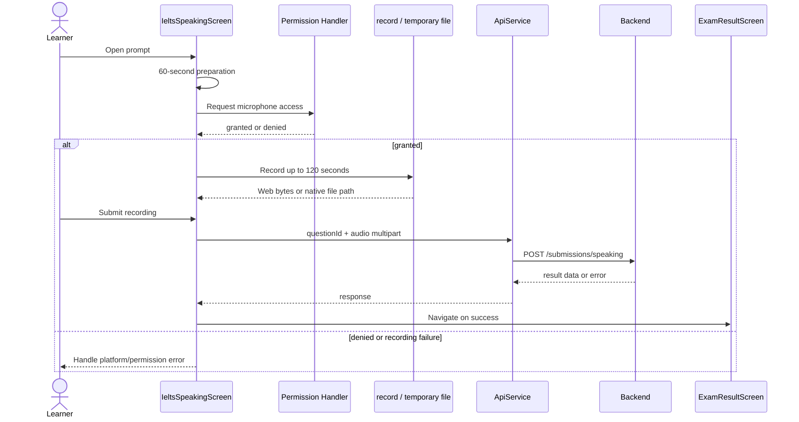

# AI Speaking Practice: Flutter Client Project Report

**Author:** Duong The Truyen  
**Affiliation:** [AFFILIATION]  
**Supervisor:** [SUPERVISOR]  
**Email:** [EMAIL]

## Abstract

AI Speaking Practice is a Flutter client for IELTS practice across Listening, Reading, Writing, and Speaking. It is configured for Android and Web and communicates with a REST backend to retrieve exams, submit answers and recordings, and display returned results. The client also provides account registration and login, session restoration, learner history, and administrative exam-management interfaces. Its source is separated into screens, models, services, configuration, and theme folders. Screen state is primarily local to widgets, and screens call a static API service. Although the application is named AI Speaking Practice, the Flutter client does not directly invoke an AI SDK or model. The author confirms that backend and AI components exist, but has not supplied the model, service design, scoring rubric, or evaluation results. Accordingly, this report documents frontend behavior only and makes no claims about AI accuracy or learning effectiveness. Available quality evidence is limited: the single existing widget test is a counter smoke test that fails against the application's UI, and an analyzer run reported 122 issues. Performance, usability, accessibility, and production deployment results were not provided. The report distinguishes implemented client functions from partial behavior, source-based inferences, and information requiring confirmation.

**Index Terms—** Flutter, IELTS practice, mobile application, Web application, REST API, software requirements.

# I. INTRODUCTION

## A. Background

English-language proficiency preparation requires repeated practice, opportunities to work with representative tasks, and a way to review submitted work. The project author states that the product objective is to support improvement of English IELTS skills. The client represents the four skill areas commonly associated with IELTS practice—Listening, Reading, Writing, and Speaking—and exposes task workflows for each. The available project data does not include user research, a survey, an institutional assessment, or outcome measurements. Thus, the motivation can be described as a product objective, but neither a specific learner need nor a learning-effectiveness claim can be validated from the supplied evidence.

AI Speaking Practice is a Flutter application with Android and Web configurations. The interface lets a learner browse exams, choose a skill or a full mock test, respond to prompts, submit work, and inspect results. The app also provides account access, history, and an administration flow for exam content. The client sends data to a backend over HTTP and consumes returned results. It does not call an AI model or AI software development kit directly; AI processing is understood to occur on the backend, but the backend design and behavior are not described in the frontend evidence.

## B. Problem Statement

The project provides a cross-platform client for accessing IELTS practice content and submitting work to a backend. The reportable engineering problem is therefore one of client-side workflow integration: the application must present exercises, accept different response types—including text and audio—communicate with remote services, and render returned data within learner and administrator interfaces.

Important elements of the broader product remain unverified. The supplied information does not define the approved stakeholder requirements, backend schema, scoring algorithm, AI model, or server-side authorization behavior. Nor does it provide empirical evidence of performance, accessibility, usability, or learner outcomes. Those boundaries matter because names such as “AI Speaking Practice” and result fields such as “fluency” or “pronunciation” cannot establish the validity of automated assessment. This report treats such fields as client-consumed response data only.

## C. Objectives

The objectives of this report are to:

1. describe the Flutter client functions that are evidenced in the supplied project data;
2. organize source-inferred behaviors as functional and non-functional requirements;
3. document the client architecture, data transfer objects, API expectations, UI flows, and deployment configuration;
4. distinguish current testing and quality evidence from proposed future tests; and
5. identify limitations and follow-up information needed for a complete system-level assessment.

The requirements and design documentation are structured with reference to the requirements, design-description, and testing standards named in the project brief; these standards are cited in the relevant sections. The document is a source-based report, not a claim that the project has undergone formal requirements approval or standards conformance assessment.

The author-provided product objective is intentionally retained at a high level. No target proficiency band, learner segment, course context, or business success measure was supplied. The report therefore avoids converting the phrase “support improvement” into a measurable outcome or asserting that a particular instructional method has been validated. Those details belong in a product or research specification and should be supplied before the report is used to evaluate educational impact.

## D. Scope and Boundaries

The scope is the Flutter frontend configured for Android and Web. The package is `ai_powered_speech_training_fe`, with version `1.0.0+1`. The source constraints are Dart `^3.10.4`; the lockfile requires Dart `>=3.10.4` and Flutter `>=3.38.4`, but neither SDK version is pinned exactly. The inspection environment reported Flutter 3.47.9 and Dart 3.13.7; those are environment versions, not declared project constraints.

No iOS, Windows, macOS, or Linux project directories were reported. No `assets/` directory was found. The backend is outside the implementation scope of this report. Specifically, there is no verified backend contract, database ERD, retention/deletion policy, AI model description, scoring rubric, model accuracy evidence, operational monitoring design, or proof of server-side authorization. The author confirmed backend and AI components exist but did not supply technical details. These omissions are stated as limitations rather than filled with assumptions.

## E. Organization

Section II summarizes the Flutter/Dart context and packages reported as used. Section III presents actors, source-inferred requirements, and use cases. Section IV describes the frontend architecture and interaction contracts. Section V inventories screens and visual conventions. Section VI records implementation and build facts. Section VII separates observed testing evidence from proposed tests. Sections VIII and IX discuss limitations and future work. The appendices list key files and provide diagram source.

# II. BACKGROUND AND TECHNOLOGIES

## A. Flutter and Dart

The client uses Flutter as its UI framework and Dart as its programming language. Flutter documentation describes the toolkit and its application-development model; Dart documentation describes the language used by the source [1], [2]. The project is organized into `screens`, `models`, `services`, `config`, and `theme` directories. This is a straightforward folder-based separation, inferred from the source inventory. It is not explicitly identified as Clean Architecture or MVVM, and the reported implementation has no repository/use-case layer or dependency-injection mechanism.

The project has no exact SDK pin. The Dart constraint is `^3.10.4`, and the lockfile requires Flutter `>=3.38.4`. SDK versions on the inspection workstation were Flutter 3.47.9 and Dart 3.13.7. Reproducible builds should rely on the project constraints and a separately documented toolchain, not assume the workstation versions are mandatory.

## B. Runtime and UI Dependencies

Table I includes only packages identified as used by the frontend. Versions are declared constraints and lockfile versions reported in the supplied project data. Package presence describes implementation dependencies; it does not by itself establish reliability, support guarantees, or platform compatibility for every app flow.

**TABLE I. PACKAGES REPORTED AS USED**

| Package | Declared version | Locked version | Client-side purpose |
|---|---:|---:|---|
| `http` | `^1.6.0` | 1.6.0 | REST requests and multipart upload [3] |
| `record` | `^6.2.0` | 6.2.0 | Speaking audio recording [4] |
| `audioplayers` | `^6.6.0` | 6.6.0 | Listening audio playback [5] |
| `fl_chart` | `^1.1.1` | 1.1.1 | Dashboard bar chart and results radar chart [6] |
| `shared_preferences` | `^2.3.2` | 2.5.4 | Session token and user-information persistence [7] |
| `permission_handler` | `^12.0.1` | 12.0.1 | Microphone-permission handling [8] |
| `path_provider` | `^2.1.5` | 2.1.5 | Temporary directories for native recordings [9] |
| `file_picker` | `^8.1.7` | 8.3.7 | Audio selection in the exam editor [10] |
| `intl` | `^0.19.0` | 0.19.0 | Date/time formatting [11] |

The source inventory also reports declared `provider`, `google_fonts`, and `flutter_svg` dependencies that were not observed in use. `cupertino_icons` is declared but has no direct import observed. These do not appear in Table I because the requested table is limited to packages actually used. The existence of the `provider` dependency must not be interpreted as Provider-based state management.

## C. Build and Development Tooling

The Android project uses Gradle Kotlin DSL, Android Gradle Plugin 8.11.1, Kotlin 2.2.20, Gradle wrapper 8.14, and Java/Kotlin target 17. The source data reports no CI/CD configuration, code generation, product flavors, or release automation. The analyzer configuration excludes `build/`, `android/`, and `web/`. No fonts or asset declarations were reported in `pubspec.yaml`, and there is no `assets/` directory.

The project includes a default Flutter README and a `README_FLUTTER.md` that describes an older structure and behaviors, including level filtering and mock data, that do not match the current source description. Current exam search is by title. The documentation mismatch may mislead contributors and should be corrected.

## D. Package Responsibilities and Platform Boundaries

The reported package set reflects distinct client responsibilities. `http` supports communication with the REST service, while `shared_preferences` persists a small set of session values. The `record` and `audioplayers` packages support audio capture and playback, respectively. `permission_handler` is relevant to microphone access, and `path_provider` supplies a temporary-directory mechanism on native platforms. `file_picker` is used in the administrator editor to choose audio, `fl_chart` renders dashboard and result visualizations, and `intl` formats dates or times. These assignments describe reported usage, not a comparison of alternatives or a verified compatibility matrix.

Platform differences are material to the Speaking flow. The summary describes separate Web and native upload paths: Web submission uses a byte-oriented upload with filename `audio.webm`, whereas native submission uses a file path and temporary-file support. A test of the native file path alone would not demonstrate that browser recording and upload work, and vice versa. The supplied data does not identify browser versions, audio codecs, or device-specific results. Consequently, platform support should be demonstrated through explicit execution evidence rather than inferred from dependency declarations.

# III. REQUIREMENTS ANALYSIS

## A. Actors and System Boundary

Actors are inferred from the client interface and persisted role behavior. The frontend distinguishes learner and administrator flows, but does not prove that the backend enforces authorization. The role shown after login comes from the login response or a persisted session. A role toggle on the login screen changes UI appearance only. A `RoleSelectionScreen` exists but is not called by the main shell; the initial screen is the login screen.

**Fig. 1. Client-side use-case diagram.**

The system boundary in Fig. 1 represents only the Flutter client. The backend is an external system from the client’s perspective. “Submit” and “manage exams” indicate client requests; they do not imply verified server processing, durable storage, or authorization policy.

## B. Functional Requirements

The following requirements are inferred from the supplied source findings. They are not represented as a signed or approved requirements baseline. “Implemented” refers to the observed client functionality and remains subject to successful backend integration where applicable.

**TABLE II. FUNCTIONAL REQUIREMENTS**

| ID | Requirement | Status and evidence qualification |
|---|---|---|
| FR-01 | The client shall support email/password sign-in and persist token, email, and role after a successful API response. | Implemented; depends on response contract. |
| FR-02 | The client shall provide registration and validate required fields and password confirmation. | Partially implemented; entered name is not sent to API. |
| FR-03 | The client shall restore session values and clear session keys on logout. | Implemented using local preferences. |
| FR-04 | The client shall fetch exams, search by title, display sections/questions, and support selection. | Implemented. |
| FR-05 | The client shall display Reading passages, accept multiple-choice/fill-in answers, and submit responses. | Implemented. |
| FR-06 | The client shall provide Listening playback controls, accept answers, and submit responses. | Implemented; runtime audio availability is platform-dependent. |
| FR-07 | The client shall display Writing prompts, count words, run a 60-minute timer, and require at least 50 characters before submission. | Implemented as described. |
| FR-08 | The client shall display Speaking prompts, provide 60 seconds of preparation, record up to 120 seconds, and upload audio. | Implemented, subject to permissions and platform support. |
| FR-09 | The client shall support a multi-skill full mock test and display aggregated results. | Implemented in client; aggregation rule is undocumented. |
| FR-10 | The client shall show result fields consumed by the UI, including scores, transcript, issues, suggestions, strengths, and a radar chart. | Implemented for provided fields; assessment validity is not established. |
| FR-11 | The client shall show history and API-provided metrics such as attempts, average score, today's attempts, and duration. | Implemented for available API data. |
| FR-12 | The client shall show administrator summary metrics and a weekly chart. | Partially implemented; weekly chart values are hard-coded. |
| FR-13 | The client shall provide administrator interfaces to create, edit, and delete exams, sections, questions, answers, and audio. | Client-side implementation; backend persistence and permissions are unverified. |

## C. Non-Functional Requirements and Quality Characteristics

The table describes observed properties and explicit gaps. It does not claim that formal acceptance thresholds exist.

**TABLE III. NON-FUNCTIONAL CHARACTERISTICS**

| ID | Quality area | Source-based finding |
|---|---|---|
| NFR-01 | Security | JWT, email, and role are held in `SharedPreferences`, not secure storage; default API URL uses HTTP. Backend authorization is not verified. |
| NFR-02 | Performance | No benchmarks, API cache, or performance tests were supplied; a timeout constant is declared but not observed in requests. |
| NFR-03 | Offline operation | No offline mode or exam-data cache was identified. |
| NFR-04 | Portability | Android and Web are configured; other native desktop/iOS projects are absent. |
| NFR-05 | Responsive layout | Some screens use `MediaQuery`/`LayoutBuilder` breakpoints and mobile/desktop layouts; no device-matrix evidence exists. |
| NFR-06 | Localization | No ARB/localization configuration was found; UI strings mix Vietnamese and English. |
| NFR-07 | Theme | Light Material 3 theme; no dark theme identified. |
| NFR-08 | Accessibility | Default Material semantics only; no accessibility audit or test results were supplied. |
| NFR-09 | Error handling | Some errors use SnackBars and some flows use `debugPrint`; centralized logging was not identified. |
| NFR-10 | Maintainability/testability | Static API service calls and absence of repositories/DI/mock abstraction constrain isolated testing, as inferred from architecture. |

## D. Use-Case Specifications

### UC-01: Sign In

**Primary actor:** Guest. **Precondition:** Login screen is available. The guest enters email and password; the client submits them to the login endpoint; a successful response is read for token and user information; the client persists the values and opens the corresponding shell. Missing fields or API errors result in a SnackBar. “Forgot password?” is not implemented. The client-side postcondition is a persisted session, not a verified server-side session-validation guarantee.

### UC-02: Register

**Primary actor:** Guest. The guest fills the registration form; the client validates required values and password confirmation; the client submits email and password; a successful response returns the user to Login. An API error is shown in a SnackBar. Although the form asks for a name, the name is not sent in the API request. No claim is made about backend account policy or password storage.

### UC-03: Complete an Exam

**Primary actor:** Learner. The client fetches the exam feed; the learner searches by title, selects a skill or full mock test, enters responses, submits, and views the returned result. The feed provides retry behavior; some submission errors appear in a SnackBar. The client does not document full-test score aggregation rules. Successful result display depends on response data being returned in the shape consumed by the result screen.

### UC-04: Complete Speaking Practice

**Primary actor:** Learner. The client presents a Speaking prompt and preparation countdown; microphone access is requested where needed; the learner records for up to 120 seconds and submits audio. Permission, recording, and upload failures may depend on platform and runtime conditions. The backend AI service and scoring methodology are not established by this use case.

### UC-05: Manage Exams

**Primary actor:** Admin. The client retrieves exam data; the administrator creates or edits sections, questions, answers, and audio; changes are submitted through the API. Delete requires confirmation. API failures can be shown in a SnackBar. Successful client calls do not, by themselves, demonstrate backend authorization or durable persistence.

The five use cases cover the main end-user paths without prescribing backend internals. UC-01 and UC-02 terminate at client-visible authentication outcomes: persisted session state or return to Login. UC-03 and UC-04 depend on a successful submission response before the result interface can be considered available. UC-05 describes an administrator editing flow but does not state the server's permissions or transaction behavior. These boundaries prevent client navigation from being misreported as a completed server transaction.

The use cases also reveal alternate paths that need explicit requirements. A failed API call may leave a user on the current form, show a SnackBar, or offer a retry depending on the screen; the supplied information does not define a consistent global policy. A denied microphone permission can prevent recording, while a network failure can prevent upload. The exact recovery options are not documented. These scenarios should be included in future acceptance criteria and tested separately on Web and native targets rather than folded into a single “happy path.”

## E. Requirement Interpretation and Traceability

The requirement identifiers in Table II are a documentation device for organizing observable client behavior, following the requirements-engineering scope of ISO/IEC/IEEE 29148 and IEEE 830 [12]. They do not imply that each requirement has an approved owner, rationale, priority, acceptance threshold, or verification record. A formal requirements baseline would need those attributes and traceability to stakeholder needs. The project data provides neither business objectives nor approved requirements; therefore, the current list should be treated as a preliminary, source-derived inventory.

The distinction between client implementation and end-to-end capability is particularly important for FR-01, FR-02, FR-04, FR-09 through FR-13. A screen can prepare or send a request, parse a response, and update the UI without proving that the server accepts the request, persists the data, enforces a role, or returns semantically valid results. For example, FR-13 identifies client-side create/edit/delete interfaces, whereas authorization and durable storage require backend evidence. Similarly, FR-10 identifies the result fields consumed by the UI; it does not certify score calibration, feedback correctness, or the validity of any assessment methodology.

FR-08 also has a platform precondition: microphone access and audio upload behavior can differ between Web and native implementations. A requirements acceptance test should name the target platform and permission state. The supplied evidence describes the client sequence and file representation but provides no browser/device matrix or executed audio test. FR-09 has an unresolved acceptance criterion because the full-exam score aggregation rule is not documented. Without a defined rule, different implementations could produce different summaries while appearing to complete the same screen sequence.

Requirements should be refined with the product owner and backend team. Specifically, the registration request must resolve whether the name is required and where it is stored; the API status and payload expectations must be confirmed; and expected behavior for missing result fields, upload errors, and invalid sessions must be written down. No additional policy is assumed in this report.

The functional requirements also have different verification boundaries. FR-01, FR-02, and FR-03 can be exercised largely through the client when the API is replaced by a controlled response source, although successful authentication and role assignment still need integration evidence. FR-04, FR-11, and FR-12 require representative API data to verify rendering and filtering. FR-05 through FR-10 require skill-specific inputs and response fixtures; Speaking and Listening additionally require audio-capable environments. FR-13 requires both UI-level editing tests and backend integration checks. This separation helps prevent a passing widget test from being mistaken for evidence of the entire client-server product.

The stated validation rules are intentionally modest: required login/registration fields, password confirmation, exam title, and the 50-character Writing threshold. The available information does not specify whether trimming whitespace counts toward the Writing threshold, whether the timer auto-submits, how empty objective answers are handled, or whether the exam title has a maximum length. Such details should not be added as requirements until product owners confirm them.

## F. Actor and Authorization Boundary

The labels Guest, Learner, and Admin describe user-facing roles as inferred from the client. A guest can open authentication screens. A learner can browse exams, perform skill workflows, inspect history, and view results. An admin can view dashboard information and access exam-management operations. These are client-perceived capabilities, not a security model.

The role toggle on the Login screen modifies UI appearance, while the actual role is obtained from the response or persisted values. The existence of separate administrator screens therefore cannot be treated as evidence that an unprivileged user is blocked from administrator endpoints. Security assurance would require server-side authorization rules and tests against the backend. The supplied frontend summary explicitly states that server-side authorization cannot be proven from the client. The unused role-selection screen also means that a proposed role-selection use case should not be presented as an active application flow.

# IV. SYSTEM DESIGN

## A. Design Scope and Views

This section uses the IEEE 1016 view-oriented framing as a documentation aid [13]. It describes a frontend software item and its external interfaces; it is not a formal conformance claim. Backend internals, database design, server components, and operational infrastructure are deliberately excluded because the supplied data does not establish them.

### 1) Context View

The Flutter app is the client boundary. Guests use authentication screens; learners use exam, history, and result flows; administrators use dashboard and exam-management screens. The client accesses an external REST API and local preferences. Audio recording/playback, file selection, permission handling, and temporary native files are mediated by Flutter plugins. The API base URL is configured as `http://localhost:3000/api` by default, with comments describing emulator and physical-device alternatives.

### 2) Composition View

The primary composition is a group of UI screens, data-transfer objects, a static API service, configuration, and theme utilities. `MyApp` and `MainScreen` create the app shell, restore session state, and select user/admin interfaces. Screens call `ApiService` directly. `ApiService` performs HTTP and multipart requests, handles token helpers and preferences, and converts relative audio paths into absolute URLs. Screens consume exam, recording, and feedback DTOs and use the theme and plugins.

**Fig. 2. Frontend component and context architecture.**

### 3) Logical View

The client’s logical data types are transfer objects, not a database ERD. `IeltsExam` contains sections; `ExamSection` contains questions; `ExamQuestion` holds question content and answer-related fields. `Recording` refers to an exam/topic and contains a `Feedback` object. `Feedback` contains overall and criterion scores and qualitative lists. The `topic` naming in the recording model persists even though the UI is exam-oriented. No client-side database schema can be derived.

**Fig. 3. Client-side data-transfer object relationships.**

### 4) Interaction View

Navigation uses imperative `Navigator.push`, `pushReplacement`, and `pop` with `MaterialPageRoute`; there are no named routes or router package. Widget state is managed mainly with `StatefulWidget`, `setState`, `FutureBuilder`, and controllers. No Provider, Bloc, Riverpod, or GetX usage was observed. Dependency injection is absent; the static API service is accessed directly.

For login, the screen collects credentials and calls the API service. The service sends the expected POST request and returns parsed data or an error. On success, the session keys are persisted and the shell is selected from the returned role; on failure, the UI reports an error. The source summary does not state password normalization, retry limits, lockout behavior, token expiration, or refresh behavior, so none is included in the interaction model.

For Writing, the client validates the minimum text length before invoking the writing submission method. The method sends a JSON body containing question identifier and essay and attaches the Authorization header. The service reads response data on HTTP 201; the UI then navigates to the result screen. The specification does not provide the response schema beyond data being consumed by the result UI. The 60-minute timer is a UI affordance; no evidence shows that it is synchronized with a server or that the backend rejects late submissions.

For Speaking, the flow includes a prompt, preparation countdown, permission request, recording, and multipart submission. The client distinguishes Web audio bytes/filename from native file paths. A successful response is used to continue to the result UI; permission, recording, or upload errors may interrupt the flow. This sequence is platform-sensitive and requires separate test cases. The report does not infer a codec, maximum upload size, compression algorithm, or server-side evaluation step.

The interaction diagrams show only client-observed call sequences and the stated API expectations. A response labeled “result data” is not a claim about a particular AI implementation.

**Fig. 4. Login interaction sequence.**

**Fig. 5. Writing submission interaction sequence.**

**Fig. 6. Speaking submission interaction sequence.**

### 5) Interface View: REST API Expectations

Table IV records the 11 method/path combinations expected by the client. This is a client-side contract summary and must be verified against the backend. Request and response descriptions are limited to the supplied data; undocumented fields are not inferred.

**TABLE IV. CLIENT-EXPECTED REST API CONTRACT**

| Method and path | Client request | Expected client response/handling |
|---|---|---|
| `POST /auth/login` | JSON `{email, password}` | Reads `token` and `user.role` / `user.email`. |
| `POST /auth/register` | JSON `{email, password}` | HTTP 201 treated as success; name not sent. |
| `GET /admin/exams` | No body specified | Expects exam list JSON. |
| `POST /admin/exams` | JSON exam or multipart `examData` + audio | HTTP 201 expected. |
| `PUT /admin/exams/:id` | JSON exam or multipart `examData` + audio | HTTP 200 expected. |
| `DELETE /admin/exams/:id` | No body specified | HTTP 200 treated as success. |
| `GET /users/history` | No body specified | Expects history/recording list. |
| `POST /submissions/writing` | JSON `{questionId, essay}` | Reads response data on HTTP 201. |
| `POST /submissions/speaking` | Multipart `questionId` + audio | Web filename `audio.webm`; native uses file path; reads response data on HTTP 201. |
| `POST /submissions/objective` | JSON `{examId, answers:[{questionId, userAnswer}]}` | Reads response data on HTTP 201. |
| `GET /admin/stats` | No body specified | Expects `totalUsers`, `totalTopics`, `totalRecordings`. |

No OpenAPI schema or official backend contract was supplied. The shape and status codes above are client expectations, not independently verified server guarantees. In particular, authorization rules, validation rules, error schemas, rate limits, audio limits, and database transactions are outside this frontend description.

The endpoint table is useful as an integration checklist. Before a release, each expected path should be compared with the backend route definition, including method, authorization header, content type, request fields, successful status, and error response. Such a comparison is especially important for multipart requests, because the client has two exam-management payload forms and separate Web/native audio handling. For history and dashboard data, the client consumes lists or named metrics, but the available summary does not state pagination, sorting, date-range filters, or nullability. These must remain open contract questions until the backend team supplies an authoritative specification.

The contract also reveals an asymmetry between documented request details and response details. Login response fields are described because the client persists the token and user values; submission responses are summarized only as data consumed by the result UI. The source summary does not state the error-body schema, whether status codes outside the success cases are mapped to domain errors, or how malformed JSON is surfaced. Those behaviors should be confirmed from the implementation and then covered by API-service tests. The report therefore avoids inventing response examples or detailed schemas.

## B. Client Data Model

The client model is intended to parse and serialize JSON associated with exams and submissions. Table V summarizes the supplied fields and relationships. The `dynamic` correct-answer field and JSON map content indicate flexible payload fields; the supplied evidence does not establish a canonical backend schema.

**TABLE V. FRONTEND DATA-TRANSFER OBJECTS**

| Type | Reported fields | Relationship / role |
|---|---|---|
| `IeltsExam` | `id`, `title`, `type`, `createdAt`, `sections` | Contains multiple `ExamSection` values. |
| `ExamSection` | `id`, `skill`, `content` (JSON map), `questions` | Contains multiple `ExamQuestion` values. |
| `ExamQuestion` | `id`, `questionText`, `questionType`, `correctAnswers` (dynamic), `content` | May include options in content. |
| `Recording` | `id`, `topicId`, `topicTitle`, `audioUrl`, `duration`, `createdAt`, `transcript`, `feedback` | Contains one `Feedback`; topic-oriented naming remains. |
| `Feedback` | `overall`, `fluency`, `pronunciation`, `grammar`, `vocabulary`, `coherence`, `strengths`, `issues`, `suggestions` | Result values consumed by UI; validity is not established. |

There is no SQLite or Hive storage layer identified in the Flutter source. No database ERD is included because the backend database is outside scope and the client data objects do not constitute a relational schema.

The transfer-object model also signals where interface documentation is incomplete. `ExamSection.content` is a JSON map and `ExamQuestion.correctAnswers` is dynamic; this allows variable question payloads but does not state required keys, nullability, or validation rules. `Recording` retains topic-oriented identifiers and names even though the primary UI is described in exam terms. These observations are useful for API alignment, but they do not justify rewriting the model or inferring the server's canonical domain vocabulary. A backend-owned schema and sample payloads are needed before a definitive entity relationship model can be prepared.

## C. Local Storage and Authentication

The client uses `SharedPreferences` for `jwt_token`, `user_role`, and `user_email`. Logout removes these keys. The token is attached to API requests in an Authorization header. There is no secure-storage dependency reported, no OAuth or Firebase authentication flow, and no refresh-token behavior. Session restoration reads persisted values; server validation during restoration was not reported. This supports a client-side restored UI state but does not prove that a token remains valid or that server-side authorization has succeeded.

The API endpoint is hard-coded in `lib/config/app_config.dart`, with a default of `http://localhost:3000/api`. Comments identify `http://10.0.2.2:3000/api` for an Android emulator and a LAN IP for a physical device. No `.env` configuration is present in the supplied description. The use of HTTP and local endpoints is a deployment constraint; HTTPS configuration for a production environment was not provided.

## D. State and Dependency Management

Widget state is held locally through stateful screens, `setState`, `FutureBuilder`, and input controllers. Screens call the static `ApiService`, creating a direct dependency between presentation code and network operations. There is no repository/use-case layer or dependency injection. This reduces the number of abstractions but makes isolated API substitution and mock-driven screen tests harder, as inferred from the reported structure. The declared `provider` package is not observed in use.

# V. USER INTERFACE DESIGN

## A. Screen Inventory

The supplied source summary reports 14 screen classes in `lib/screens/`. Table VI lists the described screen roles. The account screens, role-selection page, and main shell are included in the inventory; the role-selection page is not wired into the main flow. Exact per-screen route call graphs beyond those described are not inferred.

**TABLE VI. SCREEN INVENTORY**

| Screen | File (reported) | Function and navigation summary |
|---|---|---|
| Login | `login_screen.dart` | Email/password entry; opens registration; success enters main shell. |
| Register | `register_screen.dart` | Account creation form; returns to Login. |
| Role Selection | Screen class in `lib/screens/` | Offers User/Admin UI selection; not called by main shell. |
| Topic/Exam Feed | `topic_feed_screen.dart` | Fetches and title-searches exams; selection opens skill/full-test choice sheet. |
| History | `history_screen.dart` | Shows history/statistics and opens result details; replay control has no handler. |
| Admin Dashboard | `admin_dashboard_screen.dart` | Displays API metrics and a weekly chart with hard-coded values. |
| Exam Management | `topic_management_screen.dart` | Lists/deletes exams and opens editor. |
| Exam Editor | `exam_editor_screen.dart` | Creates/edits exam sections, questions, answers, and audio. |
| Speaking | `ielts_speaking_screen.dart` | Prompt, preparation, recording, upload, then result or full-test continuation. |
| Writing | `ielts_writing_screen.dart` | Prompt, word count, timer, validation, submission, then result/continuation. |
| Reading | `ielts_reading_screen.dart` | Passage/questions, answer entry, objective submission. |
| Listening | `ielts_listening_screen.dart` | Audio controls, answer entry, objective submission. |
| Full Exam | `full_exam_screen.dart` | Orchestrates multi-skill sections and summary. |
| Exam Result | `exam_result_screen.dart` | Displays scores, chart, transcript/feedback fields; entered from submission/history. |

## B. Design System

The UI uses a light Material 3 theme. The theme defines app bars, cards, buttons, input fields, and chips. No custom font was reported. Colors include primary blue `#3B82F6`, secondary purple `#A855F7`, success green `#10B981`, warning amber `#F59E0B`, and error red `#EF4444`; level colors are also present for Beginner, Intermediate, and Advanced, but their values were not supplied.

**TABLE VII. REPORTED COLOR PALETTE**

| Token | Color |
|---|---|
| Primary | `#3B82F6` |
| Secondary | `#A855F7` |
| Success | `#10B981` |
| Warning | `#F59E0B` |
| Error | `#EF4444` |
| Level indicators | Beginner / Intermediate / Advanced colors exist; exact values not supplied. |

Some screens use `MediaQuery` and `LayoutBuilder` breakpoints and have mobile/desktop layouts. This is evidence of responsive implementation in parts of the UI, not proof of comprehensive responsive behavior or device coverage. No accessibility audit is available. No dark theme or localization setup was identified, and some UI strings mix English and Vietnamese.

The visual system is centralized in the theme layer rather than being documented as a formal design specification. Reuse of theme definitions for app bars, cards, buttons, inputs, and chips can support a consistent appearance, but the supplied data does not include spacing tokens, typography scales, contrast ratios, icon rules, or component-state specifications. Likewise, the presence of color names and hexadecimal values does not establish that color is never the sole carrier of meaning. A design review should verify contrast and semantics on representative screens. Such a review has not been reported, so accessibility compliance is not claimed.

## C. User Flows

**Learner flow:** Login → Topics/Exam Feed → choose skill or full mock test → complete exercises → submit → Exam Result. An alternate route is Login → History → select attempt → Exam Result. The history replay button is not wired to an audio action.

**Admin flow:** Login → Admin Dashboard → Exam Management → create/edit/delete → Exam Editor → save through API. The login role toggle only changes the UI appearance; it does not set the server-side role. The actual enforcement mechanism is not available in the frontend evidence.

The learner flow combines distinct input modalities. Reading and Listening accept answers to questions; Listening adds playback and seeking. Writing accepts an essay and applies a length check while displaying a timer and word count. Speaking combines a timed preparation phase, microphone-dependent recording, and audio upload. The result screen is shared across submission/history paths and presents whatever result fields are consumed by the UI. The source summary does not establish whether every result contains every displayed feedback field; this is a reason to document optionality and test sparse response objects.

The administrator flow is content-oriented rather than learner-oriented. The dashboard reads summary metrics and shows a chart, while exam management lists content and opens the editor for changes. The supplied data reports that dashboard summary metrics come from the API but weekly chart values are hard-coded. This difference should be visible in any demonstration or evaluation: the chart should not be presented as live analytics unless it is connected to an authoritative data source.

**Screenshot placement.** The original project data indicates that screenshots should be supplied, but no screenshot files or images were included in the data. The following gray placeholders mark locations for author-provided evidence.

> **[INSERT FIGURE: Login screen showing the available account fields and role toggle.]**

> **[INSERT FIGURE: Learner exam feed and skill/full-test selection.]**

> **[INSERT FIGURE: One skill-practice screen with its answer controls.]**

> **[INSERT FIGURE: Result screen displaying only the fields actually returned by the backend.]**

> **[INSERT FIGURE: Admin dashboard and exam-management flow.]**

# VI. IMPLEMENTATION

## A. Environment and Build

For Web, the supplied instructions are `flutter pub get`, followed by `flutter run -d chrome` for local execution or `flutter build web` for a build. Android development requires the Flutter SDK, Java 17, and Android SDK; the supplied workflow is to fetch packages, run `flutter doctor`, and execute `flutter run`. Exact Android SDK version requirements are not provided.

The Android project uses Gradle Kotlin DSL, Android Gradle Plugin 8.11.1, Kotlin 2.2.20, Gradle wrapper 8.14, and target 17 for Java/Kotlin. The reported application ID remains `com.example`, and release builds use debug signing, so the current configuration is not production-ready. No flavors, automated release pipeline, CI/CD, or release process is documented. The Web manifest is configured as a standalone PWA in portrait orientation; the HTML title and description remain default values.

The project-level setup can be described as a sequence rather than a complete deployment recipe. Install a Flutter SDK satisfying the lockfile's minimum, obtain the package dependencies, and use `flutter doctor` to identify missing Android prerequisites. For Web, start the app on Chrome during local development or invoke the Web build command. For Android, provide Java 17 and an Android SDK before running the app. The supplied source data does not identify a particular Android SDK platform, device image, browser build, or hosting target, so the instructions stop at the general development commands and do not claim a fully reproducible environment.

The inspection workstation reported Flutter 3.47.9 and Dart 3.13.7. Since these are not exact project pins, a report consumer should distinguish them from the declared constraints when reproducing a build. A lockfile records package resolutions, but it does not by itself record the complete host toolchain or environment configuration. A stronger setup record would include exact SDK installation, Android SDK components, Java distribution, target device/browser, and the API environment used for a run. Those values were not supplied as project-wide configuration.

## B. API Configuration and Network Behavior

`AppConfig` supplies a hard-coded local API URL, `http://localhost:3000/api`. Comments describe host alternatives for an Android emulator (`10.0.2.2`) and physical-device LAN access. This distinction is operationally important because `localhost` on a device refers to that device, not necessarily the development computer. No environment-variable or flavor-based endpoint configuration was reported.

`ApiService` centralizes REST and multipart calls, token helpers, preferences, and relative-audio URL conversion. JSON requests cover authentication, objective submissions, writing submissions, and other data operations. Admin exam create/update and Speaking submission may use multipart data. The declared request timeout constant was not observed being applied in the requests, so it must not be treated as an enforced network bound.

The client expects HTTP status codes for selected calls: registration and submissions use 201 as success; exam update and deletion use 200; creation uses 201. These are client assumptions from the supplied summary, not a verified backend contract. The author confirmed backend and AI components exist but provided no endpoint specification, database ERD, AI service, scoring rules, or response validation evidence.

## C. Audio Recording and Playback

Speaking recording uses the `record` package and microphone permission handling. Native recording uses temporary-file support through `path_provider`; Web and native upload paths are handled separately. The client’s Web upload uses filename `audio.webm`, while native submission uses a file path. The available project data does not specify supported codecs, bitrate, sample rate, maximum file size, retention period, upload retry strategy, or behavior across specific browsers/devices. Those details require implementation or backend verification and must not be inferred.

Listening playback uses `audioplayers`. The interface reports play/pause and seeking by ±10 seconds. Audio content may also be selected for exams through `file_picker` in the admin editor. The project summary does not give a MIME-type/size validation policy for selected audio. Permission declarations in the merged Android manifest must be verified; the main manifest was not reported to explicitly declare Internet or microphone permissions, while Internet appears in debug/profile manifests.

## D. Timers, Forms, and Session Restoration

The Writing screen provides a 60-minute timer, word count, and a minimum 50-character check before submission. Speaking provides a 60-second preparation countdown and recording up to 120 seconds. These are client-side workflow constraints; no evidence establishes server-side enforcement or timer synchronization.

Login and registration validate empty required fields; registration also checks password confirmation. The exam title is validated, and Writing requires at least 50 characters. Comprehensive email syntax validation and password-strength rules were not reported. The registration form asks for a name but omits it from the request.

On startup, the app reads persisted token/role values to restore the UI state. Logout clears session keys. The client does not report server validation during restoration or refresh-token handling. This is a local session restoration mechanism, not a demonstrated authorization guarantee.

## E. Responsive Behavior and Deployment Boundaries

Some screens use responsive breakpoints with `MediaQuery` or `LayoutBuilder`; the supplied information does not identify a complete matrix of tested screen sizes. The project is configured for Android and Web only. A physical-device build process, production hosting setup, signing credentials, deployment evidence, and operational procedures were not supplied. The Android release build being configured with debug signing is an explicit limitation.

The local run instructions should be interpreted with the API's network location in mind. A browser running on the development computer can use the configured local host if the backend is listening there. An Android emulator requires the documented emulator host address; a physical device requires a reachable LAN address. The backend must be reachable from the target environment, and CORS/network policy may affect Web use, although no CORS configuration details were provided. This report does not assert that a particular deployment host or network policy has been configured.

The absence of flavors and environment files means the project data describes no built-in separation between development, test, and production endpoints. The API URL is hard-coded, so changing environments is not documented as a simple build-time selection. Future release instructions should identify the exact endpoint source and ensure that test credentials and local-only settings are not carried into production. No such release procedure is reported today.

# VII. TESTING AND QUALITY ASSESSMENT

## A. Existing Evidence

The project contains one Dart widget test: the default “Counter increments smoke test.” It expects a counter value and a `+` control that are not present in the application. The supplied test result says `flutter test` fails because text “0” is not found when `MyApp` is rendered. This test is stale relative to the app UI and does not provide meaningful evidence about login, session restoration, navigation, exam submission, or audio behavior.

No model/API unit tests, integration tests, end-to-end tests, coverage configuration, or coverage report were reported. An analyzer run reported 122 lint/info findings and warnings, with no analyzer errors in that run. Another analyzer run concurrent with tests crashed; the project data recommends rerunning it independently. The 122 count is one reported run, not a stable baseline or a claim that a current analyzer run succeeds.

Existing validations include empty login/registration fields, password confirmation, exam title, and the Writing minimum-length check. No comprehensive email or password-strength validation was reported. Some screens catch API errors and show SnackBars; retry is available in some flows. There is no centralized logging.

## B. Proposed Test Plan

All cases in Table VIII are **proposed, not yet executed**. They are derived from observable client requirements and are not test results. Execution requires test fixtures and, for API cases, an injectable or mockable HTTP boundary. Because the current API service is static and screens call it directly, adding a repository/service interface or injectable HTTP client is a recommended prerequisite for several isolated tests.

**TABLE VIII. PROPOSED TEST CASES — NOT YET EXECUTED**

| ID | Test objective | Proposed setup/action | Expected client behavior |
|---|---|---|---|
| PT-01 | Required login fields | Submit login with empty email/password. | Validation prevents the request and informs the user. |
| PT-02 | Successful login persistence | Mock a successful login response containing token and user identity/role. | Client stores reported session values and opens the corresponding shell. |
| PT-03 | Login API failure | Mock an API error. | Error is surfaced to the user; no success-shaped session is created. |
| PT-04 | Registration confirmation | Enter mismatched passwords. | Registration is blocked by client validation. |
| PT-05 | Registration request contract | Submit a valid form containing a name. | Verify the current request contains email/password and omits name; use this to document or correct the mismatch. |
| PT-06 | Session restoration and logout | Seed preferences, launch app, then log out. | Shell reflects persisted session; logout removes the session keys. |
| PT-07 | Exam feed search | Provide exam fixtures and search by title. | Matching exams are presented and selection is available. |
| PT-08 | Writing minimum length | Submit fewer than 50 characters, then a valid-length essay. | First submission is blocked; valid input invokes the writing API and handles its response. |
| PT-09 | Objective submission | Answer a Reading or Listening question and submit. | Request contains exam/question identifiers and user answers in expected shape. |
| PT-10 | Speaking permission/recording | Exercise permission denied and granted paths on supported targets. | Denial/failure is handled; granted path supports the described recording/upload flow. |
| PT-11 | Admin chart data | Load dashboard with changing API summary data. | Summary metrics reflect API data; test should expose that weekly chart values are currently hard-coded. |
| PT-12 | Result DTO rendering | Supply a result fixture with documented fields and optional lists. | UI renders available scores/feedback without claiming missing fields or quality evidence. |

## C. Test Standards and Limitations

The test-plan structure can be aligned with software test documentation concepts in ISO/IEC/IEEE 29119-3 and IEEE 829 [14]. This report does not claim that the existing test process conforms to either standard. No test plan, traceability matrix, formal acceptance criteria, risk-based coverage analysis, environment record, or execution log was supplied.

To establish quality beyond basic screen behavior, the project needs unit tests for DTO parsing and serialization, API request construction, token handling, and timer/validation rules; widget tests for authentication and navigation; and integration tests for supported audio permissions and uploads. API tests should use a controlled fake or mock transport. End-to-end tests require a documented backend contract and a non-production test environment. None of these test suites is reported as currently existing.

The analyzer result should also be interpreted narrowly. The reported count of 122 combines lint/info findings and warnings, with no analyzer errors in one run. It does not show that the code has no defects, nor does the concurrent crash establish a reproducible analyzer failure. A clean quality baseline requires rerunning analysis independently with the project toolchain, recording the command and exit status, and then classifying findings by severity and file. The report does not reproduce that run and therefore preserves the supplied result as historical evidence.

The proposed cases in Table VIII cover authentication, session persistence, feed/search, text submission, objective submission, audio permission, dashboard data, and result rendering. They are intentionally client-facing. They do not measure backend scoring accuracy, latency, throughput, security, or learning outcome. Any future result should state the target platform, test data, backend version, and whether the test is unit, widget, integration, or end-to-end. Coverage percentage should not be reported until a tool-generated coverage report exists.

For the first test increment, the stale counter test should be replaced rather than supplemented with another unrelated smoke test. A small widget suite can first establish that the real `MyApp` renders its initial authentication state and that navigation to registration is available. Service-level tests can then verify the exact JSON keys and multipart fields described in the client contract. After dependency injection or another test seam is introduced, error-path tests can assert that an API failure does not create persisted credentials or navigate to a result screen. These are recommended test objectives; they have not been executed.

# VIII. DISCUSSION

## A. Strengths

The client covers all four IELTS skill categories and includes a full mock-test flow. It centralizes network operations in an API service and defines JSON-oriented DTOs. Learner and administrator interfaces are distinct, and some screens provide loading/error/retry behavior. Selected screens include responsive layouts. The UI provides exam editing functions and handles both textual and audio submission paths. These observations describe implementation structure and visible workflow, not demonstrated product effectiveness.

## B. Limitations and Technical Debt

Several behaviors are partial or disconnected. Registration collects a name but does not transmit it. The administrator weekly chart uses hard-coded values. The role-selection page is not wired into the main shell, and the login role toggle only affects appearance. History audio replay has no handler; forgot-password is not implemented. The full-test score aggregation rule is undocumented.

The architecture uses direct static service calls from screens and has no repository/DI/mock abstraction. This limits substitution of network dependencies for testing. A timeout constant is declared but not observed in use. The API URL is hard-coded and defaults to HTTP. The default widget test is stale and fails; test coverage, integration testing, CI/CD, localization, offline support, and accessibility evaluation are absent from the supplied evidence. The README documentation is outdated. The provider, google_fonts, and flutter_svg dependencies were reported unused.

The Android release configuration uses debug signing, the application ID remains `com.example`, and runtime permissions have not been verified from a merged manifest. The Web HTML metadata remains default. These are release-readiness concerns, not proof that all runtime paths fail. Android manifest permissions must be inspected after dependency manifest merging and validated on real devices.

## C. Security and Privacy Considerations

The client stores the JWT and user identity in `SharedPreferences`; the default API URL is HTTP. These are implementation concerns that merit threat analysis and platform-specific storage decisions. The supplied data does not include a threat model, privacy policy, audio/token retention rules, compliance requirements, or server-side authorization evidence. The report therefore cannot make a security assurance claim or determine whether the backend enforces role permissions. The author is expected to provide these details or retain them as explicit limitations.

Potential improvements already identified in the project data include moving endpoint configuration into environment/flavor settings, using HTTPS for deployment, using secure storage on native targets, and evaluating a separate Web storage threat model. The merged Android manifest and actual runtime permissions should be verified before concluding whether microphone or Internet access is correctly declared. Upload file type and size validation should also be specified and tested.

## D. Threats to Validity

This report depends on a supplied summary of source inspection rather than an independently repeated audit of every file. Its requirements are inferred from implementation and may not correspond to stakeholder-approved requirements. The API contract is what the client expects; no backend contract was supplied for cross-checking. The presence of score fields does not establish scoring correctness, and AI processing is only inferred to occur at the backend. The test and analyzer counts are reported observations, not results reproduced during this document generation. No user study, device/browser matrix, accessibility review, or deployment evidence was supplied. These limitations constrain both generalization and confidence.

The author supplied the objective of supporting English IELTS skill improvement and confirmed the existence of backend/AI components, but did not supply the research or product evidence needed to evaluate those claims. The report therefore separates application functionality from educational impact. A future study should define its target participants, practice period, comparison method, outcomes, and scoring reference before interpreting changes in learner performance. This recommendation does not imply that such a study has been planned or conducted.

# IX. CONCLUSION AND FUTURE WORK

AI Speaking Practice provides an Android/Web Flutter client for IELTS skill practice, exam selection, answer/audio submission, history, results, and administrator exam editing. The frontend has a recognizable separation of screens, DTOs, API service, configuration, and theme, but remains tightly coupled through static service calls and local widget state. Its current quality evidence is limited, and the available test fails because it still tests a counter UI that the app does not contain.

A practical development roadmap can be ordered by dependency. First, establish a reproducible baseline: update the README, record the Flutter/Dart toolchain, rerun analyzer without concurrent tests, and replace the counter smoke test with tests that match the actual application. Add a testable API boundary so DTO parsing, request payloads, response handling, and session operations can be exercised without depending on a live service. This step addresses the immediate discrepancy between the current UI and its only test while creating a foundation for broader verification.

Second, resolve integration and release configuration. Obtain the backend-owned contract and use it to settle the registration-name mismatch, endpoint/status expectations, result optionality, full-test score aggregation, and audio upload constraints. Move endpoint selection out of a hard-coded local URL, use HTTPS for non-local deployment, confirm that runtime Android permissions are present after manifest merging, replace debug signing, and define the production application ID and release procedure. Web and Android should each be checked with their actual audio path and supported network endpoint.

Third, complete usability and operational evidence. Implement or remove inactive controls such as forgot-password and history replay; connect weekly chart values to an authoritative source; and add explicit email/password, upload-type, and upload-size validation where requirements define them. Document a device/browser matrix and execute responsive and accessibility checks. Add localization, offline behavior, CI, monitoring, backup, and retention policies only after their product and operational requirements are defined. These items are recommendations, not capabilities already present.

Finally, any claim that the system improves IELTS performance or that its automated feedback is accurate requires a separate evaluation design. That evidence would need defined scoring rules, an identified AI model/service and rubric, reviewed outcomes, measured accuracy, participant or test-set methodology, and reported limitations. None of those results is available in the frontend project data. The report consequently ends with implementation and verification priorities rather than an effectiveness conclusion.

Before publication, the author should also review all highlighted identity fields, insert real screenshots, and replace generic descriptions with approved project objectives and stakeholder context where available. Backend API, database, AI, privacy, release, and evaluation information should be added only from authoritative records. If those records remain unavailable, the limitation statements should remain in the final version instead of being replaced by unsupported claims.

## ACKNOWLEDGMENT

The author acknowledges [SUPERVISOR] and [INSTITUTION / ORGANIZATION] for guidance and support. Replace this placeholder with an accurate acknowledgment or remove this section if no acknowledgment is applicable.

## REFERENCES

[1] Flutter, “Flutter documentation.” [Online]. Available: https://docs.flutter.dev/. Accessed: Nov. 2026.  
[2] Dart, “Dart language documentation.” [Online]. Available: https://dart.dev/guides. Accessed: Nov. 2026.  
[3] Dart packages, “http package.” [Online]. Available: https://pub.dev/packages/http. Accessed: Nov. 2026.  
[4] Dart packages, “record package.” [Online]. Available: https://pub.dev/packages/record. Accessed: Nov. 2026.  
[5] Dart packages, “audioplayers package.” [Online]. Available: https://pub.dev/packages/audioplayers. Accessed: Nov. 2026.  
[6] Dart packages, “fl_chart package.” [Online]. Available: https://pub.dev/packages/fl_chart. Accessed: Nov. 2026.  
[7] Dart packages, “shared_preferences package.” [Online]. Available: https://pub.dev/packages/shared_preferences. Accessed: Nov. 2026.  
[8] Dart packages, “permission_handler package.” [Online]. Available: https://pub.dev/packages/permission_handler. Accessed: Nov. 2026.  
[9] Dart packages, “path_provider package.” [Online]. Available: https://pub.dev/packages/path_provider. Accessed: Nov. 2026.  
[10] Dart packages, “file_picker package.” [Online]. Available: https://pub.dev/packages/file_picker. Accessed: Nov. 2026.  
[11] Dart packages, “intl package.” [Online]. Available: https://pub.dev/packages/intl. Accessed: Nov. 2026.  
[12] ISO/IEC/IEEE, *Systems and software engineering—Life cycle processes—Requirements engineering*, ISO/IEC/IEEE 29148:2018; and IEEE, *IEEE Recommended Practice for Software Requirements Specifications*, IEEE Std 830-1998.  
[13] IEEE, *IEEE Standard for Information Technology—Systems Design—Software Design Descriptions*, IEEE Std 1016-2009.  
[14] ISO/IEC/IEEE, *Software and systems engineering—Software testing—Part 3: Test documentation*, ISO/IEC/IEEE 29119-3; and IEEE, *IEEE Standard for Software and System Test Documentation*, IEEE Std 829-2008.

# APPENDIX A. KEY SOURCE FILE INVENTORY

The supplied source inventory reports approximately 59 project files excluding `.dart_tool`, build outputs, and `.git`; 21 Dart files in `lib/` (approximately 6,707 lines); one Dart test file (approximately 24 lines); 14 screen classes; three model files containing five described model classes; one `ApiService`; and 11 API method/path combinations. These are approximate source statistics from the project data, not a new filesystem recount.

| Area | Key files / contents | Report role |
|---|---|---|
| Application shell | `lib/main.dart` | Entry point, session restoration, shell/navigation and role-based UI. |
| Configuration | `lib/config/app_config.dart` | API URL and timeout constant. |
| API client | `lib/services/api_service.dart` | REST/multipart calls, preferences, token helpers. |
| Models | `lib/models/exam.dart`, `recording.dart`, `feedback.dart` | Client DTOs and JSON representation. |
| Screens | `lib/screens/` | Login, registration, learner/admin, exam skills, and results. |
| Theme | `lib/theme/` | Palette and Material theme. |
| Tests | `test/widget_test.dart` | Default counter smoke test; reported failing against the app. |
| Package configuration | `pubspec.yaml`, `pubspec.lock` | SDK constraints and dependency versions. |
| Android | `android/` | Gradle and platform configuration; release signing/permissions require verification. |
| Web | `web/` | Web manifest and HTML entry point. |

No `ios/`, desktop-platform project directories, `assets/`, or `.github/` CI configuration were reported. The backend schema and source are not included in this frontend inventory.

# APPENDIX B. DIAGRAM SOURCE

The diagrams embedded in this document are rendered from the following Mermaid source. They represent frontend behavior only.

## B.1 Use-Case Diagram

## B.2 Component Diagram

## B.3 Client Model Diagram

## B.4 Login Sequence

## B.5 Writing Submission Sequence

## B.6 Speaking Submission Sequence

